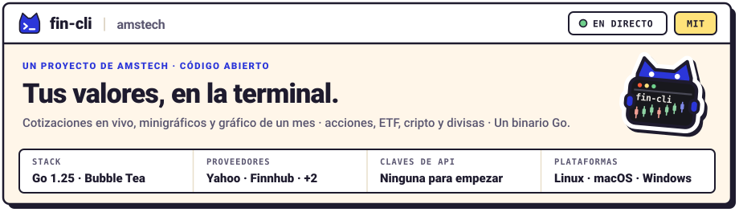
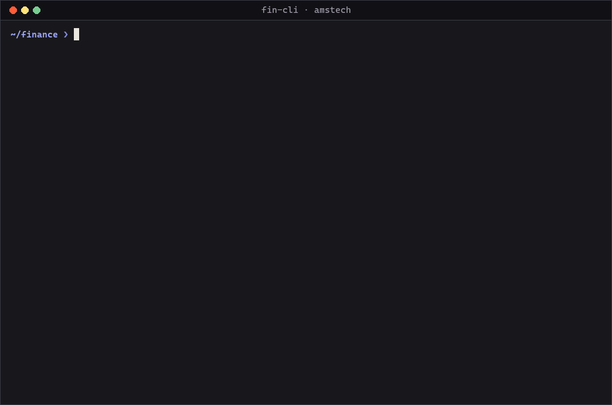

<p align="center">
  
</p>

<p align="center">
  <a href="https://github.com/msalexms/fin-cli/releases"></a>
  <a href="https://github.com/msalexms/fin-cli/actions/workflows/ci.yml"></a>
  <a href="https://go.dev"></a>
  
  <a href="LICENSE"></a>
</p>

<p align="center">
  <a href="README.md">English</a> · <strong>Español</strong>
</p>

<p align="center">
  
  <br>
  <em>Cotizaciones y gráficos en vivo, orden por variación diaria, añadir un valor y cambiar ajustes sin reiniciar.</em>
</p>

---

## Novedades

**v0.2.0 — marca AMSTech, núcleo reconstruido, funciona sin claves.**

- **Funciona desde el primer momento** — Yahoo Finance da cotizaciones y gráficos sin clave de API; Finnhub, Twelve Data y Alpha Vantage añaden fundamentales y respaldo cuando los configuras.
- **Estilo AMSTech** — el panel y la salida de `quote` usan la paleta AMSTech (índigo de marca, Thor y colores de señal suaves) y respetan el fondo de tu terminal.
- **Panel rediseñado** — pantalla de ayuda (`?`), confirmación al borrar, reordenación manual, orden persistente, minigráficos y diseño adaptable hasta 44×12.
- **Ajustes al instante** — claves, proveedores e intervalo se validan y se aplican sin reiniciar.
- **Datos correctos** — variación diaria correcta en Yahoo, valores internacionales (`SAN.MC`, `VOD.L`) que ya no bloquea Finnhub y muchas otras correcciones. Detalle en el [changelog](CHANGELOG.md).

---

## Funciones

- **Panel interactivo** — lista de seguimiento con minigráficos de 10 sesiones y variación diaria, y un panel de detalle con precio, datos clave y gráfico de un mes.
- **Cotización al momento** — `fin-cli quote AAPL` imprime una ficha con gráfico; `--format json` para scripts.
- **Acciones, ETF, índices, cripto y divisas** — todo lo que liste Yahoo Finance: `AAPL`, `SAN.MC`, `^GSPC`, `BTC-USD`, `EURUSD=X`.
- **ISIN** — `fin-cli add ES0113900J37` resuelve el ISIN con OpenFIGI.
- **Respaldo entre proveedores** — se prueba un proveedor tras otro; si fallan todos, se muestra la última cotización guardada marcada como *offline*.
- **Pensado para scripts** — `export` a CSV/JSON, `config get/set` y códigos de salida con significado.
- **Un único binario** — Go 1.25, sin CGO ni dependencias. Linux, macOS y Windows.

---

## Instalación

```bash
# Binario para Linux (cambia amd64 por arm64 o armv7)
curl -sL https://github.com/msalexms/fin-cli/releases/latest/download/fin-cli_linux_amd64.tar.gz | tar xz
sudo install -m755 fin-cli /usr/local/bin/fin-cli

# Paquetes .deb / .rpm y archivos para macOS / Windows en la página de releases.

# Con Go 1.25+
go install github.com/msalexms/fin-cli/cmd/fin-cli@latest
```

---

## Uso

```bash
fin-cli                          # abre el panel
```

La primera ejecución crea un `config.toml` documentado y una lista vacía. Pulsa `a` para añadir valores.

```bash
fin-cli quote SAN.MC             # ficha con gráfico de un mes
fin-cli quote ES0113900J37       # los ISIN se detectan solos
fin-cli add AAPL MSFT SAN.MC     # se validan en línea; --no-validate sin conexión
fin-cli remove MSFT              # alias: rm
fin-cli list                     # -f json para JSON
fin-cli export -f json -o cotizaciones.json
fin-cli config list              # todos los ajustes (claves ocultas)
fin-cli config set finnhub.api_key <CLAVE>
fin-cli config set polling_interval 2m
fin-cli purge                    # vacía la caché
```

Códigos de salida: `0` correcto · `1` error inesperado · `2` uso o entrada no válida · `3` red, proveedor caído o límite de peticiones · `4` falta la clave o fue rechazada · `5` valor no encontrado.

---

## Teclado

| Tecla | Acción |
| --- | --- |
| `↑` `↓` · `k` `j` | Anterior / siguiente |
| `g` · `G` | Primero / último |
| `K` `J` · `Mayús`+`↑` `↓` | Subir / bajar el valor (orden manual) |
| `a` | Añadir valor o ISIN |
| `d` | Quitar el seleccionado (pide confirmación) |
| `r` · `R` | Actualizar seleccionado / todos |
| `s` | Cambiar orden: manual, % ↓, % ↑, símbolo, volumen (se recuerda) |
| `c` | Ajustes: claves, proveedores, intervalo, orden |
| `?` | Ayuda |
| `q` · `Ctrl`+`C` | Salir |

---

## Proveedores

| Proveedor | Clave | Cotización | Gráfico | Notas |
| --- | --- | --- | --- | --- |
| **Yahoo Finance** | No | ✓ | ✓ | Cobertura mundial, cripto y divisas. Endpoint no oficial. |
| **Finnhub** | [Gratis](https://finnhub.io) | ✓ | — | Añade PER, BPA, beta, dividendo y capitalización. Sobre todo EE. UU. en el plan gratuito. |
| **Twelve Data** | [Gratis](https://twelvedata.com) | ✓ | ✓ | 800 peticiones/día. |
| **Alpha Vantage** | [Gratis](https://www.alphavantage.co/support/#api-key) | ✓ | ✓ | 25 peticiones/día: último recurso. |
| **OpenFIGI** | Opcional | — | — | ISIN → ticker. |

Los valores fuera de EE. UU. usan los sufijos de Yahoo: `SAN.MC` (Madrid), `VOD.L` (Londres), `SAP.DE` (Xetra), `7203.T` (Tokio).

---

## Configuración

`config.toml` se crea documentado y conserva sus comentarios al cambiarlo desde la CLI o el panel de ajustes. Las claves se resuelven en este orden: opción de línea de comandos → variable de entorno (`FIN_CLI_FINNHUB_KEY`, …) → `config.toml`. `fin-cli config path` muestra dónde están los archivos.

Más detalle (rutas por sistema, desarrollo, estructura) en el [README en inglés](README.md).

---

<p align="center">
  <sub>Hecho para mí, compartido con todos · un proyecto de <a href="https://amstech.dev">AMSTech</a> · Licencia MIT</sub>
</p>
