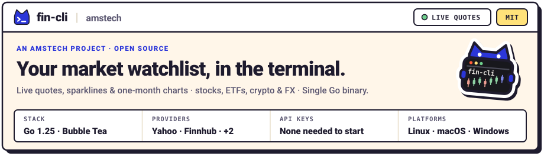
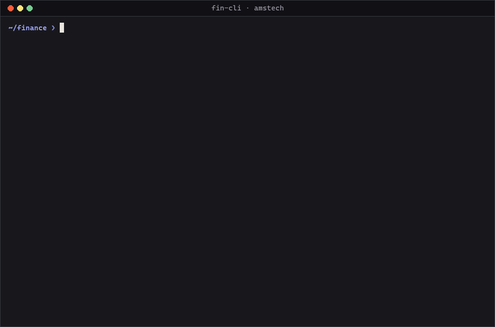

<p align="center">
  
</p>

<p align="center">
  <a href="https://github.com/msalexms/fin-cli/releases"></a>
  <a href="https://github.com/msalexms/fin-cli/actions/workflows/ci.yml"></a>
  <a href="https://go.dev"></a>
  
  <a href="LICENSE"></a>
</p>

<p align="center">
  <strong>English</strong> · <a href="README.es.md">Español</a>
</p>

<p align="center">
  <a href="#whats-new">What's new</a> ·
  <a href="#features">Features</a> ·
  <a href="#install">Install</a> ·
  <a href="#usage">Usage</a> ·
  <a href="#keyboard">Keyboard</a> ·
  <a href="#providers">Providers</a> ·
  <a href="#configuration">Configuration</a> ·
  <a href="CHANGELOG.md">Changelog</a>
</p>

<p align="center">
  
  <br>
  <em>Live quotes and charts, sort by daily change, add a ticker, and change settings without restarting.</em>
</p>

---

## What's new

**v0.2.0 — AMSTech brand, rebuilt core, works without keys.**

- **Works out of the box** — Yahoo Finance serves quotes and charts with no API key; Finnhub, Twelve Data and Alpha Vantage add fundamentals and fallbacks when you configure them.
- **AMSTech look** — the dashboard and `quote` output use the AMSTech palette (brand indigo, Thor, soft signal colors) and keep your terminal background.
- **Redesigned dashboard** — help screen (`?`), remove confirmation, manual reordering, persistent sort order, sparklines, adaptive layout down to 44×12.
- **Settings that apply instantly** — API keys, providers and the refresh interval are validated and take effect without restarting.
- **Accurate data** — correct daily change on Yahoo, international tickers (`SAN.MC`, `VOD.L`) no longer blocked by Finnhub, and dozens of other fixes. See the [changelog](CHANGELOG.md).

---

## Features

- **Interactive dashboard** — watchlist with 10-session sparklines and daily change, and a detail pane with price, stats and a one-month chart.
- **One-shot quotes** — `fin-cli quote AAPL` prints a snapshot with a chart; `--format json` for scripts.
- **Stocks, ETFs, indices, crypto and FX** — anything Yahoo Finance lists: `AAPL`, `SAN.MC`, `^GSPC`, `BTC-USD`, `EURUSD=X`.
- **ISIN support** — `fin-cli add US0378331005` resolves the ISIN through OpenFIGI.
- **Provider fallback** — quotes are tried provider by provider; when all fail, the last cached quote is shown and marked *offline*.
- **Scriptable** — `export` to CSV/JSON, `config get/set`, meaningful exit codes.
- **Single static binary** — Go 1.25, no CGO, no runtime dependencies. Linux, macOS and Windows.

---

## Install

```bash
# Linux binary (swap amd64 for arm64 or armv7)
curl -sL https://github.com/msalexms/fin-cli/releases/latest/download/fin-cli_linux_amd64.tar.gz | tar xz
sudo install -m755 fin-cli /usr/local/bin/fin-cli

# .deb / .rpm packages and macOS / Windows archives are on the releases page.

# With Go 1.25+
go install github.com/msalexms/fin-cli/cmd/fin-cli@latest
```

---

## Usage

```bash
fin-cli                          # open the dashboard
```

The first run creates a documented `config.toml` and an empty watchlist. Press `a` to add tickers.

### Commands

```bash
fin-cli quote AAPL               # snapshot with a one-month chart
fin-cli quote US0378331005       # ISINs are detected automatically
fin-cli quote BTC-USD -f json    # JSON for scripts (--no-chart skips history)

fin-cli add AAPL MSFT SAN.MC     # validated online; --no-validate when offline
fin-cli remove MSFT              # alias: rm
fin-cli list                     # -f json for JSON

fin-cli export                   # CSV to stdout
fin-cli export -f json -o quotes.json

fin-cli config list              # every setting (keys masked)
fin-cli config set finnhub.api_key <KEY>
fin-cli config set polling_interval 2m
fin-cli config edit              # open config.toml in $EDITOR
fin-cli config path              # where files live

fin-cli purge                    # clear the cache
fin-cli --version
```

Global flags: `--config`, `--watchlist`, `--debug` (writes a log with API keys redacted) and `--finnhub-key`, `--twelvedata-key`, `--alphavantage-key`, `--openfigi-key` for one-off overrides.

### Exit codes

| Code | Meaning |
| --- | --- |
| 0 | OK |
| 1 | Unexpected error |
| 2 | Invalid input or usage |
| 3 | Network error, provider down or rate limited |
| 4 | Missing or rejected API key |
| 5 | Ticker not found |

---

## Keyboard

| Key | Action |
| --- | --- |
| `↑` `↓` · `k` `j` | Select previous / next |
| `g` · `G` | First / last |
| `K` `J` · `Shift`+`↑` `↓` | Move the ticker up / down (manual order) |
| `a` | Add a ticker or ISIN |
| `d` | Remove the selected ticker (asks for confirmation) |
| `r` · `R` | Refresh selected / all now |
| `s` | Cycle order: manual, % change ↓, % change ↑, symbol, volume (remembered) |
| `c` | Settings: API keys, providers, refresh interval, order |
| `?` | Help |
| `q` · `Ctrl`+`C` | Quit |

The header shows when data was last updated; quotes refresh automatically at the configured interval (5 minutes by default). In the detail pane, *partial data* means the source has no fundamentals and *offline* means every provider failed and the last cached quote is shown.

---

## Providers

| Provider | Key | Quotes | Chart | Notes |
| --- | --- | --- | --- | --- |
| **Yahoo Finance** | No | ✓ | ✓ | Global coverage, crypto and FX. Unofficial endpoint. |
| **Finnhub** | [Free](https://finnhub.io) | ✓ | — | Adds P/E, EPS, beta, dividend yield and market cap. Mostly US on the free tier. |
| **Twelve Data** | [Free](https://twelvedata.com) | ✓ | ✓ | 800 requests/day. |
| **Alpha Vantage** | [Free](https://www.alphavantage.co/support/#api-key) | ✓ | ✓ | 25 requests/day: last-resort fallback. |
| **OpenFIGI** | Optional | — | — | ISIN → ticker. 25 req/min without key, 250 with one. |

The default quote chain is `finnhub, yahoo`: Finnhub is skipped until it has a key, so Yahoo answers out of the box. Every failure moves on to the next provider, so a ticker Finnhub does not cover is still served by Yahoo. Non-US tickers use Yahoo suffixes: `SAN.MC` (Madrid), `VOD.L` (London), `SAP.DE` (Xetra), `7203.T` (Tokyo).

---

## Configuration

`config.toml` is created on first run with every option documented, and keeps its comments when changed from the CLI or the settings panel.

```toml
polling_interval = "5m"                                     # min 30s
providers = ["finnhub", "yahoo"]                            # quote chain, in order
history_providers = ["yahoo", "twelvedata", "alphavantage"] # chart chain

[finnhub]
api_key = ""            # or FIN_CLI_FINNHUB_KEY

[ui]
sort_mode = "manual"    # manual | change_desc | change_asc | alpha | volume
```

API keys are resolved in this order: command-line flag → environment variable (`FIN_CLI_FINNHUB_KEY`, `FIN_CLI_TWELVEDATA_KEY`, `FIN_CLI_ALPHAVANTAGE_KEY`, `FIN_CLI_OPENFIGI_KEY`) → `config.toml`.

| File | Linux / BSD | macOS / Windows |
| --- | --- | --- |
| Config and watchlist | `$XDG_CONFIG_HOME/fin-cli/` (`~/.config/fin-cli/`) | user config dir (`~/Library/Application Support`, `%AppData%`) |
| Cache | `$XDG_CACHE_HOME/fin-cli/` (`~/.cache/fin-cli/`) | user cache dir |
| Debug log | `$XDG_STATE_HOME/fin-cli/fin-cli.log` | user config dir |

`fin-cli config path` prints the exact locations. Files are written atomically with `0600` permissions and a lock, so the dashboard and the CLI can run at the same time.

---

## Development

```bash
make test     # go test ./... -race
make lint     # go vet + staticcheck
make build    # bin/fin-cli with version info
```

Project layout:

```
cmd/fin-cli/        entry point
internal/
  app/              wiring: config → providers → services (live reconfiguration)
  cli/              cobra commands and the quote renderer
  tui/              Bubble Tea dashboard
  quotes/           provider chains, cache, stale fallback, rate limit
  providers/        yahoo, finnhub, twelvedata, alphavantage, openfigi
  domain/           types, errors and ports (no dependencies)
  config/ watchlist/ cache/ fsutil/ httpx/ isin/ format/ chart/ theme/ locale/ logging/ version/
```

Releases are built by GoReleaser from a `v*` tag.

---

<p align="center">
  <sub>Built for me, shared with all · an <a href="https://amstech.dev">AMSTech</a> project · MIT License</sub>
</p>
